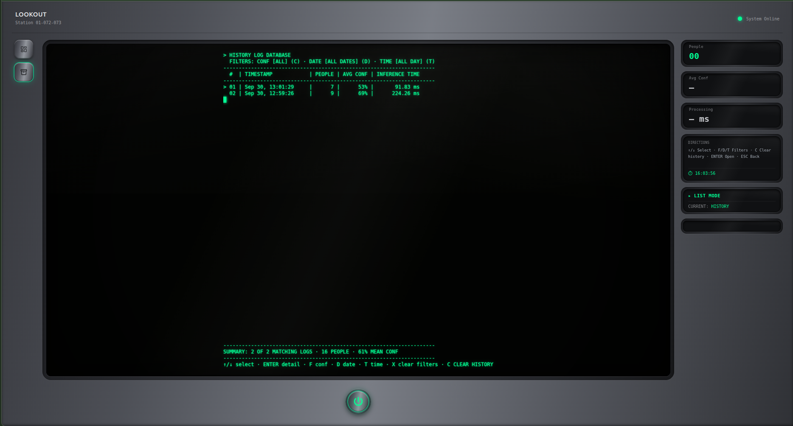

# Detecto

A real-time person detection and counting system. Upload an image or a video file, or stream live webcam frames, and Detecto returns how many people are in it, where they are, and how confident the model is. Every detection is stored so counts can be reviewed over time.

- **Backend**: FastAPI + YOLOv8n (Ultralytics), SQLite for history. Serves person detection for a still image, a single video frame, or a stream of frames.
- **Frontend**: React + Vite + Tailwind CSS v4, featuring:
  - **Detection View**: Image upload, video-file upload (sampled frame-by-frame), and live webcam streaming, with real-time bounding-box overlays, count, confidence and processing time.
  - **History View**: Interactive CRT data table — columns `name, type, people, avg conf, inference time, timestamp` — with multi-criteria filtering (Confidence threshold, Date, Time of Day), a dynamic metrics summary, and `localStorage` offline caching.

---

## Architecture

```
 React / Vite (frontend/)                 FastAPI (backend/)
┌──────────────────────────┐   HTTP    ┌────────────────────────────────────┐
│ Detection View           │ ────────► │ POST /detect                       │
│  image / video / webcam  │           │   decode → CLAHE contrast →        │
│                          │           │   YOLOv8n (person class, conf≥0.4) │
│ History View             │ ◄──────── │   → boxes + count, row saved       │
│  data table + filters    │           │ GET  /history  (optional filters)  │
└──────────────────────────┘           │ POST /reset                        │
                                       └──────────────┬─────────────────────┘
                                                      │
                                              SQLite (detections.db)
```

### Inference & Frontend Processing:
- **Model**: `yolov8n.pt`, pretrained on COCO, filtered to the `person` class (`conf ≥ 0.4`). Model warm-up occurs on server startup so the one-time load cost never lands on the first request.
- **Preprocessing**: OpenCV CLAHE contrast adjustment on the backend; frame scaling, canvas normalization and JPEG encoding on the frontend.
- **Live Stream Engine**: Captures webcam frames via an HTML5 canvas and posts them to `/detect`, scheduling the next capture only after the previous response returns.
- **Video Upload Pipeline**: The browser seeks a detached `<video>` at 8 Hz, sends each ≤640 px frame with `media_type=video`, then builds a track-id timeline. Playback interpolates boxes between samples so the overlay stays locked to the picture instead of trailing it.
- **Video History Roll-up**: All frames of one video are compiled server-side into a **single** history row — peak people count, mean confidence, average inference time and frame count — tagged with `media_name`.
- **Bounding Boxes**: Pixel coordinates are normalized to 0–1 fractions on the client and rendered dynamically over image/video stages.
- **History Filtering**: Dual-layer filtering (backend query params + client-side `localStorage` filtering for date, time of day and min confidence).

---

## Detection Inputs

| Input | How it runs | History result |
|---|---|---|
| **Image** (JPG / PNG) | Posted straight to `/detect`. | One row, `media_type = image`. |
| **Video** (MP4 / WEBM / MOV) | Sampled at 8 Hz in the browser; each frame posted to `/detect`; boxes interpolated during playback. | **One** row compiled from every frame, `media_type = video`. |
| **Webcam** | Frames captured from the live stream and posted to `/detect`. | One row per captured frame, `media_type = image`. |

---

## API Specification

| Endpoint | Method | Payload / Params | Response |
|---|---|---|---|
| `/detect` | `POST` | `multipart/form-data`: `file` (required) plus optional `media_type` (`image`\|`video`), `media_name`, `frame_index`, `total_frames` | JSON with `count`, `boxes[]` (`x, y, width, height, confidence`), `average_confidence`, `inference_time_ms`, `processed_image`. `400`/`422` on invalid, empty, or incomplete video-frame payloads. |
| `/history` | `GET` | Params: `date_from`, `date_to`, `min_confidence`, `limit` | JSON array of records (`id`, `timestamp`, `person_count`, `average_confidence`, `inference_time_ms`, `media_type`, `media_name`, `frame_count`), newest first. |
| `/reset` | `POST` | None | `{"status": "cleared"}` |

`media_type`/`media_name`/`frame_index`/`total_frames` are only sent by the video path: they tag a request as one frame of a video so the backend can compile all of its frames into a single history row when the **last** frame (`frame_index == total_frames - 1`) arrives.

---

## Setup & Running Instructions

### Requirements
- **Python**: 3.10+ (tested on Python 3.12 / 3.14)
- **Node.js**: v18+ (tested with Vite 8 & React 19)

### 1. Backend Setup

```bash
cd backend
python -m venv .venv
source .venv/bin/activate

# Install CPU PyTorch first to avoid multi-GB CUDA binaries
pip install torch torchvision --index-url https://download.pytorch.org/whl/cpu
pip install -r requirements.txt

# Start FastAPI server (runs on http://localhost:8000)
uvicorn main:app --reload
```

### 2. Frontend Setup

```bash
cd frontend
npm install

# Configure API URL environment variable
cp .env.example .env             # VITE_API_BASE_URL=http://localhost:8000

# Start Vite development server (runs on http://localhost:5173)
npm run dev
```

### 3. Environment Variables

| Location | Variable | Purpose |
|---|---|---|
| `frontend/.env` | `VITE_API_BASE_URL` | Base URL the browser calls (default `http://localhost:8000`). Loaded by Vite. |
| `backend/.env.example` | `DATABASE_URL`, `CORS_ORIGIN` | Intended values (`sqlite:///./detections.db`, `http://localhost:5173`). The backend currently uses these defaults directly in code and does not auto-load a `.env` file. |

### 4. Running the Tests

```bash
# Backend (from backend/)
./.venv/bin/python -m pytest -q                  # 35 unit/integration tests
./.venv/bin/python scripts/validate.py --markdown # reproduce the metrics below

# Frontend (from frontend/)
npm test                                          # Vitest + jsdom unit tests
npm run lint                                      # oxlint
```

---

## Detection Quality & Validation Metrics

### Test methodology

- **Dataset**: 18 images in `backend/samples/` (mirrored in `frontend/public/samples/`), spanning single people, pairs, small groups, dense crowds, night/low-light, and occlusion. `backend/samples/ground_truth.json` holds a hand-counted number of clearly visible people per image; the dense-crowd images are marked `count: null` ("stress" images) because they cannot be counted exactly by eye and are excluded from accuracy/false-positive maths.
- **Harness**: `backend/scripts/validate.py` runs the exact same model loader, preprocessing and threshold as `POST /detect`, but calls the model directly so no history rows are written. Reproduce everything below with `./.venv/bin/python scripts/validate.py --markdown`.
- **Hardware**: CPU-only (no CUDA, PyTorch CPU build). Inference time is wall-clock around `model.predict` only.
- **Formulas** (count-based, because ground truth is a person count rather than box labels):
  - `Detection accuracy = Σ min(detected, truth) ÷ Σ truth` over labelled images — a "correct detection" is a person the model actually found.
  - `False-positive rate = Σ max(detected − truth, 0) ÷ Σ detections` over labelled images.
  - `Average confidence = mean of every confidence score`.
  - `Reliability = images processed without error ÷ total images`.
- Timings are hardware-specific; re-run on your machine to get your own numbers.

### Results

| Metric | Target | Measured | Met |
|---|---|---|---|
| **Detection accuracy** | `≥ 85 %` | **95.2 %** (20 of 21 visible people) | yes |
| **False positives** | `≤ 10 %` | **0.0 %** (0 non-person boxes) | yes |
| **Avg inference time** | `≤ 1.5 s` | **~128 ms** per image (CPU) | yes |
| **Avg confidence** | `≥ 0.70` | **0.652** all detections / **0.80** labelled images only | **no (see note)** |
| **System reliability** | `100 %` | **100 %** (18 / 18 processed clean) | yes |

> **Note on the confidence target.** The headline mean across *all* detections is **0.652**, just under the 0.70 target; restricted to the 10 labelled images it is **0.80**. The shortfall comes entirely from the dense-crowd and low-light "stress" images (~112 detections at 0.54–0.67 confidence, where people are small and overlapping), which pull the overall mean down. Both figures are reported rather than dropping the hard cases.

### Per-image results

Reproduced from `validate.py`. `truth = -` marks an uncountable stress image (feeds reliability/timing/confidence only).

| Image | Truth | Found | Avg conf | ms |
|---|---|---|---|---|
| boda_boda_pair.jpg | 2 | 2 | 0.64 | 232 |
| crowd_essence.jpg | - | 17 | 0.65 | 135 |
| crowd_festival_cc0.jpg | - | 5 | 0.54 | 104 |
| empty_street.jpg | 0 | 0 | 0.00 | 151 |
| indoor_cafe.jpg | 5 | 4 | 0.79 | 108 |
| lowlight_nieuwmarkt.jpg | - | 5 | 0.60 | 140 |
| occlusion_greenwich.jpg | - | 17 | 0.62 | 104 |
| occlusion_pride.jpg | - | 7 | 0.58 | 131 |
| pair_men_cold.jpg | 2 | 2 | 0.90 | 115 |
| pair_men_wiknic.jpg | 2 | 2 | 0.83 | 148 |
| pair_students_campus.jpg | 2 | 2 | 0.72 | 116 |
| single_cyclist_amsterdam.jpg | 1 | 1 | 0.87 | 154 |
| single_cyclist_unsplash.jpg | 1 | 1 | 0.83 | 104 |
| small_group_columbia.jpg | 3 | 3 | 0.87 | 109 |
| sports_lineup.jpg | - | 22 | 0.56 | 129 |
| street_crossing_kibiwott.jpg | - | 11 | 0.67 | 108 |
| street_shibuya.jpg | - | 8 | 0.73 | 112 |
| trio_students_tulane.jpg | 3 | 3 | 0.80 | 102 |

### Failure cases and limitations

- **Dense crowds** (`crowd_essence`, `sports_lineup`, `occlusion_greenwich`): counts are plausible but individual confidences drop to ~0.55–0.65 as people overlap; the model tends to under-count heavy occlusion and merged silhouettes.
- **Low light** (`lowlight_nieuwmarkt`): CLAHE helps, but confidence and recall fall; 5 of an uncertain number of people were found.
- **Small/distant people** (`indoor_cafe`): the far-right person is a sliver and is missed — the one labelled miss (4 of 5).
- **Edge/partial people**: figures clipped by the frame border are frequently not detected, which keeps false positives near zero but lowers recall at the edges.
- **No false positives** were observed on the labelled set — every box landed on a person, including the `empty_street` night scene (0 detections).

### What worked well / what could be improved

**Worked well**: person-only filtering made the output precise (0 false positives); CLAHE kept night and indoor contrast usable; the YOLOv8n CPU build comfortably beats the 1.5 s budget (~128 ms); the pipeline never crashed across all 18 images.

**Could be improved**: the aggregate confidence metric is dragged below target by stress images — a confidence-weighted count or a higher `conf` threshold on crowded scenes would help. Small/distant person recall is the main accuracy gap. A smaller model input (e.g. `imgsz=416`) trades a little accuracy for a large speedup, useful for the live stream. The backend also holds in-progress video buffers in memory with no TTL, so a cancelled upload leaves an entry until restart.

---

## Frontend User Navigation Shortcuts

- `↑ / ↓ / ← / →`: Navigate menus, options, and history rows.
- `ENTER` / `SPACE`: Select a menu option / open a history record.
- `ESC` / `BACKSPACE`: Return to the previous level / cancel video pre-processing / stop the live stream.
- `F`: Cycle the Confidence threshold filter (`ALL`, `≥50%`, `≥60%`, `≥70%`, `≥80%`, `≥90%`).
- `D`: Cycle the Date filter (`ALL DATES`, `TODAY`, `PAST 24H`, `PAST 7D`).
- `T`: Cycle the Time-of-day filter (`ALL DAY`, `MORNING`, `AFTERNOON`, `EVENING`, `NIGHT`).
- `X`: Reset all active filters.
- `C`: Clear history — opens a `[Y] YES / [N] NO` confirmation before erasing the database.

---

## Screenshots

Captured from the running app (backend on `:8000`, frontend on `:5173`), using two of the `backend/samples/` images through the real upload flow.

**Detection View — `small_group_columbia.jpg`, a clear scene:**


3 of 3 people found, 87% average confidence, 353 ms.

**Detection View — `crowd_essence.jpg`, a dense stress scene:**


17 people found at 65% average confidence.

**History View, listing detections:**



---

## Project Structure

```
detecto/
├── backend/
│   ├── main.py                 # FastAPI app & lifecycle (CORS, DB init, model warm-up)
│   ├── routes/
│   │   ├── detect.py           # POST /detect (image + video-frame ingest, history roll-up)
│   │   └── history.py          # GET /history & POST /reset
│   ├── models/record.py        # SQLite schema (DetectionRecord) & Pydantic models
│   ├── utils/preprocessing.py  # OpenCV CLAHE image enhancement
│   ├── scripts/validate.py     # Evaluation-metrics runner
│   ├── tests/                  # pytest: detect, history, preprocessing (35 tests)
│   └── samples/                # 18 test images + ground_truth.json
├── docs/
│   └── screenshots/            # UI screenshots
├── frontend/
│   ├── vitest.config.js        # Test runner config (jsdom)
│   ├── public/samples/         # Demo benchmark image assets
│   └── src/
│       ├── api/Client.js       # Axios HTTP client
│       ├── components/         # Console chassis & CRT screen components
│       ├── hooks/              # Webcam, video precompute, upload, keyboard, history
│       ├── stores/             # Domain Zustand stores (Navigation, Detection, Filters)
│       ├── utils/              # Detection normalisation & timeline interpolation
│       └── test/setup.js       # jest-dom matchers + jsdom stubs
```
