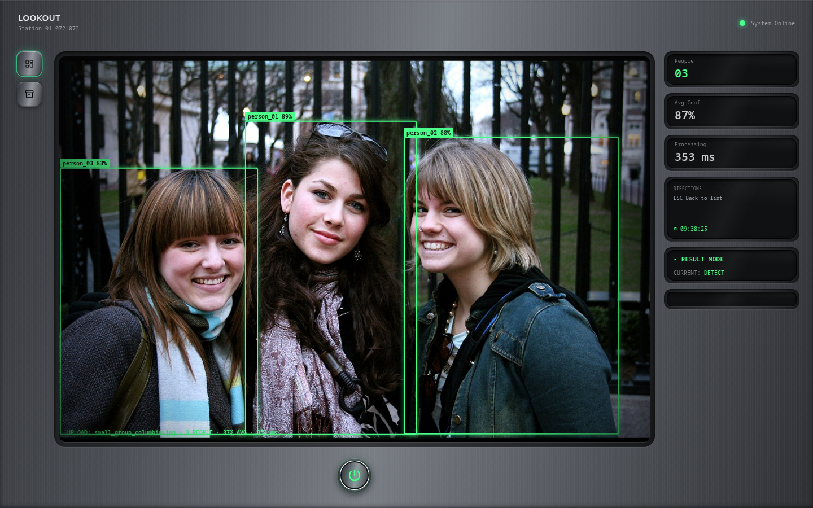
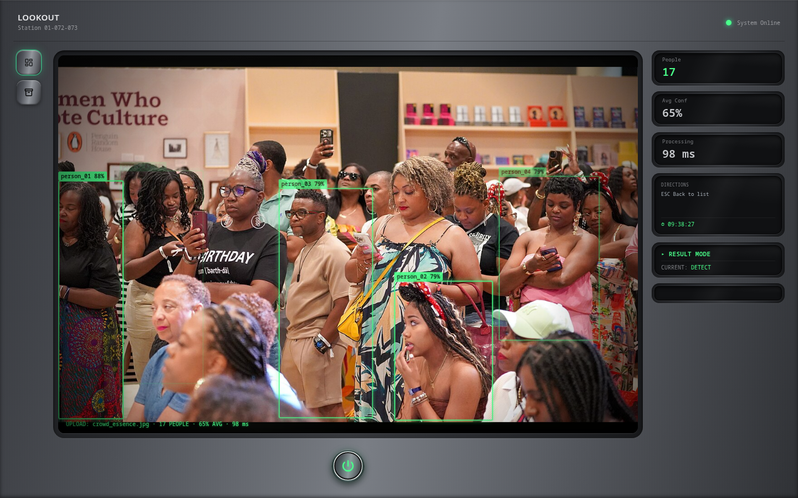
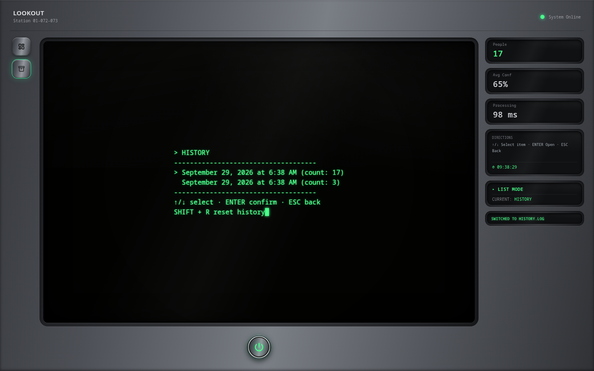

# Detecto

A real-time person detection and counting system. Upload an image and Detecto returns how many people are in it, where they are, and how confident the model is. Every detection is stored so counts can be reviewed over time.

- **Backend**: FastAPI + YOLOv8n (Ultralytics), SQLite for history.
- **Frontend**: React + Vite, with a Detection View (upload, boxes drawn over the image, count, confidence, processing time) and a History View.

The two halves only talk over the HTTP API below and can be run and tested separately.

## Architecture

```
 React / Vite (frontend/)                 FastAPI (backend/)
┌──────────────────────────┐   HTTP    ┌────────────────────────────────────┐
│ Detection View           │ ────────► │ POST /detect                       │
│  upload, boxes, stats    │           │   decode → CLAHE contrast →        │
│                          │           │   YOLOv8n (person class, conf≥0.4) │
│ History View             │ ◄──────── │   → boxes + count, row saved       │
│  table of past detections│           │ GET  /history  (optional filters)  │
└──────────────────────────┘           │ POST /reset                        │
                                       └──────────────┬─────────────────────┘
                                                      │
                                              SQLite (detections.db)
```

Inference details:

- The model is `yolov8n.pt`, pretrained on COCO, filtered to the `person` class. It is loaded and warmed up at server startup, so the first request is not slower than the rest.
- Images are decoded with OpenCV (this also rejects corrupt files with a 400), then given a CLAHE contrast adjustment before inference. Resizing and normalisation are handled inside Ultralytics.
- Box coordinates in the response are pixels of the original image, top-left origin.
- `inference_time_ms` measures the model call only, not upload or decoding.

## API

| Endpoint | Purpose |
|---|---|
| `POST /detect` | multipart field `file` (JPEG or PNG). Returns `count`, `boxes[]` (`x`, `y`, `width`, `height`, `confidence`), `average_confidence`, `inference_time_ms`, `processed_image` (currently always `null`). `400` for non-JPEG/PNG, empty or corrupt files. |
| `GET /history` | Stored detections, newest first. Optional filters: `date_from`, `date_to` (ISO 8601, converted to UTC; no offset means UTC), `min_confidence` (0-1), `limit` (1-1000). |
| `POST /reset` | Clears all history. |

## Setup

Requirements: Python 3 (developed on 3.14) and a recent Node.js. The first backend start downloads `yolov8n.pt` (about 6 MB), so it needs internet once.

### Backend

```bash
cd backend
python -m venv .venv && source .venv/bin/activate

# CPU-only PyTorch first. The default wheel pulls several GB of CUDA libraries.
pip install torch torchvision --index-url https://download.pytorch.org/whl/cpu
pip install -r requirements.txt

uvicorn main:app --reload        # http://localhost:8000
```

If you install torch from one index and torchvision from another you can hit `operator torchvision::nms does not exist`. Install both from the same index, as above.

`.env.example` lists `DATABASE_URL` and `CORS_ORIGIN`, but the app does not read a `.env` file yet: the database is `./detections.db` and the allowed origin is `http://localhost:5173`, both set in code.

### Frontend

```bash
cd frontend
npm install
cp .env.example .env             # VITE_API_BASE_URL=http://localhost:8000
npm run dev                      # http://localhost:5173
```

## Testing methodology

### Automated tests

```bash
cd backend
python -m pytest
```

31 tests in `backend/tests/`: `/detect` (real model on sample photos: counts, response shape, PNG, empty/corrupt/wrong-type uploads, rows saved), `/history` (ordering, every filter, UTC offsets, validation errors, `/reset`) and the preprocessing step. Each test gets its own throwaway SQLite file, so the real `detections.db` is never touched.

### Detection quality

Detection quality is measured against real photos, not only unit tests.

- **Images**: 18 photos in `backend/samples/` (mirrored in `frontend/public/samples/`), all from Wikimedia Commons under CC0, public domain, CC BY or CC BY-SA. Credits are in `ATTRIBUTION.md` next to them.
- **Ground truth**: `backend/samples/ground_truth.json`. Ten images have a hand-counted number of clearly visible people (single people, pairs, small groups, an empty street, a cafe with partial occlusion). The other eight are dense crowds, a football line-up, Shibuya crossing and a night street, which are too dense to count exactly by eye. Those are marked as *stress images*: they count toward reliability, timing and confidence, but not accuracy or false positives.
- **Script**: `backend/scripts/validate.py` runs the same model, preprocessing and threshold as `/detect` (without writing to the history database).

```bash
cd backend
python scripts/validate.py --markdown          # default threshold, 0.4
python scripts/validate.py --conf 0.6          # try another threshold
```

The ground truth has counts but no box labels, so the metrics are count-based:

| Metric | Formula used |
|---|---|
| Detection accuracy | `sum(min(found, truth)) / sum(truth)` over the ten labelled images |
| False positives | `sum(max(found - truth, 0)) / all detections` over the ten labelled images |
| Avg inference time | mean model time per image over all 18 images |
| Avg confidence | mean confidence of every detection (see below) |
| Reliability | images processed without an error / images tried |

Because there are no boxes, "found 3, truth 3" is scored as correct even if a box landed on the wrong thing. With 21 labelled people the accuracy figure is coarse: a single miss moves it by about 5 points.

## Results

Measured on a CPU-only machine (no GPU), threshold 0.4, all 18 images:

| Metric | Measured | Target | Met |
|---|---|---|---|
| Detection accuracy | 95.2% (20 of 21 people) | ≥ 85% | yes |
| False positives | 0.0% (0 of 20 detections) | ≤ 10% | yes |
| Avg inference time | ~115 ms | ≤ 1500 ms | yes |
| Avg confidence | **0.652** (0.80 on the ten labelled images) | ≥ 0.70 | **no** on all images, yes on labelled |
| Reliability | 100% (18 of 18) | 100% | yes |

### How confidence is reported

Average confidence is the one target the default settings do not meet across the full image set, so it is reported three ways rather than as one number:

| View | Detections | Avg confidence |
|---|---|---|
| All 18 images | 112 | **0.652** |
| The ten labelled images only | 20 | **0.80** |
| The eight stress images only | 92 | about 0.62 |

- The gap comes from the crowd scenes. People there are small, partly hidden or motion-blurred, and the model is less sure about them. On clear, countable scenes the average is 0.80.
- The brief defines this metric over *valid* detections. Only the labelled images let us check that a detection is valid, and there it clears 0.70. On the stress images we cannot say which detections are valid, so those numbers are shown but not counted as a pass.
- Confidence is not accuracy. A low-confidence box can still be a real person, and the labelled-image accuracy is separate (95.2%).
- The labelled set is small and skews easy, so 0.80 should not be read as what to expect on any camera.

**Effect of the detection threshold.** Raising the threshold lifts the mean mechanically, because the low-confidence detections are simply dropped. It is shown here so the trade-off is visible, not as a recommended fix:

| Threshold | Accuracy | False positives | Avg confidence (all) | Avg confidence (labelled) | Detections (all) |
|---|---|---|---|---|---|
| **0.4 (default)** | 95.2% | 0.0% | 0.652 | 0.80 | 112 |
| 0.5 | 95.2% | 0.0% | 0.699 | 0.80 | 91 |
| 0.6 | 90.5% | 0.0% | 0.753 | 0.81 | 67 |
| 0.7 | 76.2% | 0.0% | 0.809 | 0.85 | 44 |

At 0.6 every target is met, but 45 of the 112 detections disappear, and we cannot tell how many of those were real people in the crowd scenes. For a counting tool, missing people is the costlier error, so the default stays at 0.4. The threshold is `CONFIDENCE_THRESHOLD` in `backend/routes/detect.py` if a deployment prefers to trade recall for higher average confidence.

### Per-image results

Labelled images (`found` at threshold 0.4):

| Image | People | Found | Avg confidence |
|---|---|---|---|
| single_cyclist_unsplash | 1 | 1 | 0.83 |
| single_cyclist_amsterdam | 1 | 1 | 0.87 |
| pair_men_cold | 2 | 2 | 0.90 |
| pair_men_wiknic | 2 | 2 | 0.83 |
| pair_students_campus | 2 | 2 | 0.72 |
| boda_boda_pair | 2 | 2 | 0.64 |
| small_group_columbia | 3 | 3 | 0.87 |
| trio_students_tulane | 3 | 3 | 0.80 |
| indoor_cafe | 5 | 4 | 0.79 |
| empty_street | 0 | 0 | none |

Stress images (no exact count, found at threshold 0.4): crowd_essence 17, sports_lineup 22, occlusion_greenwich 17, street_crossing_kibiwott 11, street_shibuya 8, occlusion_pride 7, crowd_festival_cc0 5, lowlight_nieuwmarkt 5.

### Failure cases and limits

- **Occlusion (indoor_cafe)**: the one miss. A man in a red checked shirt sits partly behind another person holding a menu. The model does detect him, but at 0.30 and 0.24 confidence, below the 0.4 threshold. This is the recall cost of the threshold in one example.
- **Dense crowds**: counts are likely low. In crowd_festival_cc0 many people are only heads or raised arms, and only 5 are found. These images are not scored for accuracy because we have no reliable ground truth for them; the counts above should be read as "what the model returns", not "how many people there are".
- **Night scenes**: in lowlight_nieuwmarkt the model finds 5 people at 0.60 average confidence, and the scene has more figures at the far end of the street that we could not count by eye.
- **Motion blur**: in street_shibuya the long exposure blurs most of the crowd. The model finds 8 people, at 0.73 average confidence, mostly the sharper foreground figures.
- **Not measured**: performance on a real camera feed, on GPU, with other image sizes, and box-level precision (there are no box labels).

## Screenshots

Captured from the running app (backend on `:8000`, frontend on `:5173`), using two of the `backend/samples/` images through the real upload flow.

**Detection View — `small_group_columbia.jpg`, a clear scene:**



3 of 3 people found, 87% average confidence, 353 ms.

**Detection View — `crowd_essence.jpg`, a dense stress scene:**



17 people found at 65% average confidence. There is no ground truth for this image (see *Failure cases and limits* above), so this shows the model's output on a hard scene, not a verified count.

**History View**, after those two uploads:



## Project layout

```
backend/
  main.py                 app setup, CORS, startup (DB + model warmup)
  routes/detect.py        POST /detect, model loading
  routes/history.py       GET /history, POST /reset
  models/record.py        SQLAlchemy record + Pydantic schemas
  utils/preprocessing.py  CLAHE contrast adjustment
  scripts/validate.py     measures the five metrics on backend/samples/
  samples/                18 test images, ground_truth.json, ATTRIBUTION.md
frontend/
  src/                    App, components, pages, hooks, API client
  public/samples/         the same images, for trying the Detection View
```

## Known gaps

- `processed_image` (annotated image in the response) is not implemented; the frontend draws the boxes itself.
- No `.env` loading yet.
- The API tests cover behaviour, not detection quality; `scripts/validate.py` is the check for accuracy.
